# markcut — Markdown-to-Video Engine

Write a storyboard in markdown, get a rendered video with TTS narration and subtitles.

```bash
# Render a storyboard to MP4
npx markcut render storyboard.md

# Preview with live edit (edit .md file, player auto-reloads)
npx markcut preview storyboard.md --edit

# Fast structure preview: show TTI/TTV prompts as placeholders, skip slow generation
npx markcut preview storyboard.md --storyboard

# Label clips in a stream tree
npx markcut preview labels.json --label --port=3031
```

## How it works

```
storyboard.md  ──[parse]──▶  DescriptiveRoot  ──[compile]──▶  Stream Tree  ──[Remotion]──▶  MP4
                                  │                                  │
                             resolveMediaDurations()             <Sequence>
                             resolveScripts() → TTS              <Series>
                             resolveSubtitles() → VTT            , <OffthreadVideo>
```

1. **Write** a storyboard in markdown (scenes with `## headings`, media with `-` bullets)
2. **Parse** the markdown into a descriptive tree
3. **Resolve** media durations (ffprobe), generate TTS narration (edge-tts), transcribe to VTT (whisper)
4. **Compile** the descriptive tree into a stream tree (the low-level Remotion JSON)
5. **Render** with Remotion — no React code needed

## Features

| Feature | Description |
|---|---|
| **Markdown input** | Write `## Scene` headings, `- bullet` leaves. Components via `jsx:"<Tag />"` syntax |
| **JS imports block** | `` ```js imports `` code fence with real ESM `import` statements instead of YAML |
| **Dynamic components** | Load any React component from npm, GitHub, or any URL via `import { X } from "pkg"` |
| **Tween animation** | `tween(from, to)` function calls in JSX for frame-accurate numeric animation |
| **Compiled input** | Pre-compiled stream tree for direct Remotion rendering |
| **TTS narration** | `script` field → edge-tts CLI → WAV audio. Configurable engine (mlx-audio, custom) |
| **STT subtitles** | TTS audio → whisper → VTT → root subtitle overlay with animated caption types (typewriter, fade, bounce, etc.) |
| **Tween animation** | `tween(from, to)` function calls in JSX for frame-accurate numeric animation |
| **Built-in Markdown** | `<Markdown source="..." />` renders markdown with GFM, custom plugins, and component overrides. No imports needed |
| **Built-in Mermaid** | `<Mermaid source="..." theme="dark" />` renders Mermaid diagrams as inline SVG. No imports needed |
| **Styling** | Inline `style` strings on any node for CSS. JSX components use inline React styles |
| **Live edit** | `--edit` watches the input file, re-runs pipeline, auto-reloads player |
| **Player language** | Player UI supports English/Chinese. Use `?lang=en` or `?lang=zh` |
| **Storyboard** | `--storyboard` fast structure preview: replaces TTI/TTV prompts with placeholder components, skips slow generation. Implies `--edit` |
| **Label mode** | `--label` interactive player with per-scene label input, saves to labels.json |
| **CLI** | `render`, `preview` commands for MP4 export and Remotion Studio |
| **Programmatic** | `MarkCut` / `DescriptiveComposition` React components for embedding |

## Example

```md
# video
width:1080 height:1920 fps:30 layout:series

## Hook
layout:parallel script:"Set the mood with a beautiful landscape"
- image src:cover.jpg duration:3

## Features
layout:transitionSeries transition:fade transitionTime:0.4 script:"Show what we built"
- component duration:6 jsx:"<DeviceMockup src='screenshot.png' />"
- component duration:4 jsx:"<StatCounter value={100} suffix='K' label='Users' />"
```

Components are registered via frontmatter `imports:` or a `` ```js imports `` code block:

````
```js imports
import { DeviceMockup } from "mockup-component"
import { StatCounter } from "stat-counter"

// Inline component definition
export function Greeting({ name }) {
  return <h1 style={{color: '#fff'}}>Hello {name}</h1>;
}
```
````

### Dynamic Components

Any React component from npm, GitHub, or any URL can be imported and used directly in JSX expressions. The engine loads them at render time via esm.sh — no build step required.

```markdown
- component duration:3 jsx:"<PieChart data={[{value:40,color:'#E38627'}]} />"
```

Inline components can be defined entirely in the imports block using `export function`, making the video self-contained with no external files.

## Docs

| Document | What it covers |
|---|---|
| [docs/markdown-strict-descriptive.md](docs/markdown-strict-descriptive.md) | Markdown descriptive syntax reference |


## Variants

Create different versions of the same video for different platforms, languages, or formats using **variant sections** in your markdown.

### Defining Variants

Add `# variant-name` headings alongside `# video` (the base). Each variant can override any property using variant-prefixed keys:

```markdown
# video
width:1080 height:1920 fps:30 layout:series

## Intro
layout:parallel
- component duration:3 jsx:"<h1>Hello</h1>"
- image src:default.jpg duration:3

# zh
## Intro
layout:parallel
- component duration:3 zh:"<h1>你好</h1>"         ← bare key overrides jsx (primary content)
- image zh-src:zh-image.jpg src:default.jpg       ← zh-src overrides src

# youtube
width:1920 height:1080 fps:30                     ← different aspect ratio
## Intro
layout:parallel
- component duration:3 jsx:"<h1>YouTube Hello</h1>"
```

Two override mechanisms:
- **Variant-prefixed keys**: `zh-src` → `src`, `zh-jsx` → `jsx`, `zh-script` → `script`
- **Bare variant keys**: `zh:"<h1>你好</h1>"` replaces the node's primary content key (`jsx` for components, `src` for images/video, `script` for audio)

### Interactive NeoY Design Mode (before formal Review)

The **existing Markcut Previewer** can be opened as a standalone NeoY view
using only the mounted source `video.md`. There is no special Markcut CLI mode,
browser Session ID, revision identity, or file-watcher process.

1. Call `markcut.preview({path: "/absolute/path/video.md", readonly: true})`.
   Markcut compiles and publishes the latest player assets. For a source in an
   existing NeoY file mount, the tool result includes `designUrl`, an HTTPS
   link to the standalone player.
2. Open `designUrl` in a browser. For interactive side-by-side design, call
   WebHelm's **independent** `webhelm design start --url '<designUrl>'` while a
   ChatGPT conversation tab is active. Markcut does not control Split View.
3. After editing `video.md`, referenced media, or its Editor Decision sidecar,
   call the same `markcut.preview` tool with `readonly: true` again. The open
   page polls the published file pointer and updates **Original / variants /
   Editor Decisions** in place. No user-facing Review or approval is required.
4. Stop the WebHelm Session through WebHelm. Markcut has no browser lifecycle.

The source must be under a configured NeoY file mount. The URL uses the
existing public, read-only `/files/` transport, so mount only content suitable
for exposure at that address. This mode does not send review decisions.

## Multi-Variant Preview Server

The `preview` command accepts multiple `--variant` flags, each defining a separate compilation target. Variants are compiled **sequentially** (not in parallel) to avoid resource contention from CLI tools like whisper and ffprobe.

```bash
# Preview 4 variants simultaneously
npx markcut preview storyboard.md \
  --variant default \
  --variant zh-tiktok \
  --variant en-tiktok \
  --variant youtube

# Each variant is served at its own URL:
#   http://localhost:3001            → default
#   http://localhost:3001/zh-tiktok  → zh + tiktok chain
#   http://localhost:3001/en-tiktok  → en + tiktok chain
#   http://localhost:3001/youtube    → youtube
```

Compound variant labels (like `zh-tiktok`) are split on `-` to form a **variant chain** — the parser applies `zh` overrides first, then `tiktok` overrides on top. Each variant gets its own compiled output and subtitle directory. Component bundles are stored in a shared cache (`.markcut/generated/components/`) — identical imports across variants reuse the same bundle.

### Variant-Aware Browser

The browser player reads `window.VARIANT` from the URL path and fetches the correct compiled data via `/api/video-data?variant=<name>`. A **variant switcher bar** at the top of the player lets you jump between variants instantly.

### Player UI Language (EN / ZH)

The player UI (edit panel, placeholders, tooltips) supports English and Chinese.

- `?lang=en` for English
- `?lang=zh` for Chinese

Examples:

- `http://localhost:3001?lang=en`
- `http://localhost:3001?lang=zh`

If `lang` is not provided, the player falls back to browser language (Chinese browsers default to `zh`, otherwise `en`).

### Map Language (EN / ZH)

`map` nodes support `language`/`lang` and `region` keys.

```md
- map duration:3 lang:zh region:CN waypoints:[31.23,121.47,"上海";39.90,116.40,"北京"]
- map duration:3 lang:en region:US waypoints:[37.77,-122.41,"SF";34.05,-118.24,"LA"]
```

Locale shorthand normalization:

- `lang:zh` / `language:zh` → `zh-CN` (default region `CN`)
- `lang:en` / `language:en` → `en` (default region `US`)

## `.markcut/` Directory Layout

When you run `preview` or `render`, all generated artifacts live under `.markcut/` next to the source file. With multiple variants, each gets its own subdirectory:

```
.markcut/
  generated/                    ← shared, content-addressed (across all variants & files)
    tts/                        ← TTS narration audio (content-hash filenames)
    media/                      ← TTI/TTV media (content-hash filenames)
    includes/                   ← compiled sub-video JSON (content-hash)
    components/                 ← component bundles (content-hash, shared across variants)
  <basename>/                   ← per-source-file
    default/                    ← default variant artifacts
      compiled.json             ← compiled stream tree
      subtitles.vtt
    zh-tiktok/                  ← variant-specific artifacts
      compiled.json
      subtitles.vtt
    youtube/
      compiled.json
      subtitles.vtt
```

- **`generated/`** — shared artifacts using content-hash filenames, so identical scripts/prompts across different variants reuse the same cached file
- **`generated/components/`** — component bundles shared across all variants and source files. Identical imports produce the same content hash, so variants with the same component registrations reuse the same bundle
- **`<basename>/<variant>/compiled.json`** — the compiled stream tree for each variant, cached to disk for fast restarts
- The server serves `.markcut/` as a document root, so components at `.markcut/generated/components/abc.js` are served as `/generated/components/abc.js`

The `.markcut/` directory is gitignored by default — it's regenerated on each run.

## Architecture

```
src/
├── entry.tsx              ← Library entry: MarkCut + DescriptiveComposition
├── index.ts               ← Remotion registerRoot (for studio/render CLI)
├── Root.tsx               ← Remotion Composition wrapper
├── schema/                ← Zod schemas for all stream types
├── types/                 ← React renderers (Folder, Video, Image, Audio, etc.)
├── descriptive/           ← Compiler, markdown parser, resolve pipeline
├── themes/                ← Theme presets + ThemeProvider
├── render/
│   ├── cli.mjs            ← CLI entry point
│   └── tts.ts             ← TTS via CLI template + variable substitution
├── player/
│   ├── server.mjs         ← Unified server (--edit, --label, preview)
│   ├── components/        ← React control components for all modes
│   │   ├── index.ts
│   │   ├── EditControls.tsx
│   │   ├── LabelControls.tsx
│   │   └── VariantBar.tsx
│   ├── pipeline.ts        ← Pipeline entry (bundled to pipeline.mjs)
│   └── browser.tsx        ← Browser player (React, bundled to player.js)
├── utils/                 ← Duration calc, VTT parser, helpers
└── tests/                 ← Vitest integration tests
```

## Scripts

```bash
npm run render      # render a JSON stream tree to MP4
npm run preview     # open Remotion Studio
npm run vision      # analyze images/videos in a folder (metadata + AI perception)
npm run typecheck   # TypeScript type check
npm test            # run unit + integration tests
```

## Vision Pipeline

```bash
# Full pipeline: extract metadata → normalize → AI perception (images & videos)
npx markcut vision <folder>

# With interactive labeling step before AI
npx markcut vision <folder> --label

# Provide context about people/places
npx markcut vision <folder> --instruct "the girl is Maggie, the man in red is me"
```



```mermaid
flowchart LR
    subgraph Input[Input]
        A[Media Folder<br/>images + videos]
    end

    subgraph Metadata["1. Metadata Extraction"]
        B[exiftool / ffprobe]
        C[metadata.json<br/>width, height, created,<br/>GPS location, duration]
    end

    subgraph Normalize["2. Normalization"]
        D[ffmpeg resize<br/>images → 384px<br/>videos → 360p]
    end

    subgraph Label["Optional: Labeling"]
        E[Build preview tree<br/>with seed]
        F[Label preview server<br/>user annotates scenes]
        G[Merge labels → userHints<br/>into metadata.json]
    end

    subgraph Image["3. Image Perception"]
        H[ITT: image-to-text<br/>mlx-vlm model]
        I[Perception saved:<br/>description]
    end

    subgraph Video["4. Video Understanding"]
        J[VTT: video-to-text<br/>mlx-vlm model]
        K[STT: speech-to-text<br/>whisper]
        L[VTT→ overall desc]
        M[STT → VTT subtitles]
        N[Build merged segment<br/>boundaries]
        O[LLM merges boundaries<br/>into final segments]
        P[Per-segment vision<br/>clip extraction + ITT]
    end

    subgraph Output[Output]
        Q[metadata.json<br/>with perception desc,<br/>subtitles & segments]
    end

    A --> B --> C --> D
    D --> Image
    D --> Video
    C -.->|--label| E --> F --> G --> D
    Image --> H --> I --> Q
    Video --> J --> L
    Video --> K --> M
    L --> N
    M --> N
    N --> O --> P --> Q

    style Input fill:#1a1a2e,stroke:#16213e,color:#fff
    style Metadata fill:#0f3460,stroke:#16213e,color:#fff
    style Normalize fill:#533483,stroke:#16213e,color:#fff
    style Label fill:#e94560,stroke:#16213e,color:#fff
    style Image fill:#0f3460,stroke:#16213e,color:#fff
    style Video fill:#0f3460,stroke:#16213e,color:#fff
    style Output fill:#1a1a2e,stroke:#16213e,color:#fff
```

### Vision CLI Options

| Option | Description |
|---|---|
| `--label` | Add interactive labeling step before AI pipeline (opens browser preview) |
| `--instruct "text"` | Background context about people/places (injected into AI prompts) |
| `--prompts-file <path>` | Custom prompts markdown file (default: `src/vision/vision_prompts.md`) |
| `--vtt-sample-interval <n>` | Sample one video frame every N seconds for VTT (default: 5) |
| `--pick <files>` | Comma-separated filenames to process (skip others) |
| `--skip-stt` | Skip speech-to-text for videos |
| `--dry-run` | Show what would be processed without running AI |
| `--show-prompts` | Print the prompts template file and exit |

### Default Vision backend priority

Markcut Vision is remote-first by default so ordinary perception does not require a heavy local VLM on the host Mac. Explicit `--itt` / `--vtt` flags and `MARKCUT_ITT_CLI` / `MARKCUT_VTT_CLI` environment variables still override these defaults.

Default ITT tries, in order:

1. **Browser ChatGPT Temporary Chat** through `chatgpt-browser-infer` (or `MARKCUT_CHATGPT_BROWSER_INFER_CLI`). The Neo runtime owns browser automation, isolation, attachment readiness, retries, and cleanup.
2. **Codex CLI remote vision**, trying profiles from `MARKCUT_CODEX_VISION_PROFILES` (default `zai,default`). On this Mac that means the lightweight Z.ai profile first, then the normal Codex/OpenAI profile.
3. **Local MLX MiniCPM** as the final fallback only. Override its model with `MARKCUT_LOCAL_VISION_MODEL`.

Default VTT is intentionally empty. Markcut therefore performs its existing deterministic chronological frame extraction (5–10 representative frames, controlled by `--vtt-sample-interval`) and sends those frames through the same ITT priority chain. Set `--vtt` or `MARKCUT_VTT_CLI` when a dedicated video backend is explicitly desired.

To expose the Neo Browser ChatGPT runtime on this Mac:

```bash
ln -sf "$HOME/Workspace/neo/skills/chatgpt-browser-worker/bin/chatgpt-browser-infer" "$HOME/.local/bin/chatgpt-browser-infer"
```

Useful policy overrides:

```bash
export MARKCUT_CODEX_VISION_PROFILES='zai,default'
export MARKCUT_CHATGPT_BROWSER_INFER_CLI='/path/to/chatgpt-browser-infer'
# Explicit custom backends still win:
export MARKCUT_ITT_CLI='my-image-backend --prompt "{prompt}" {input}'
export MARKCUT_VTT_CLI='my-video-backend --prompt "{prompt}" {input}'
```

## Architecture

### Caller-selected CLI profiles

The repository ships [`profiles/default.json`](profiles/default.json) as the
source of the original built-in CLI defaults, without changing their provider
commands. External Python and npm tools use `uvx` and `npx`; bundled adapters
use `node`. Node/npm, uv, ffmpeg/ffprobe, and any provider credentials still
need to be available. Copy the default or create a partial trusted local JSON
file and select it at invocation time. Profiles configure providers, not creative content or output
resolution; the same Markdown can be used with different profiles.

```json
{
  "tts": "uvx edge-tts --voice zh-CN-YunxiNeural --text \"{input}\" --write-media \"{output}\"",
  "stt": "uvx --from openai-whisper whisper \"{input}\" --model base --output_format vtt --output_dir \"{output}\"",
  "vtt": ""
}
```

```sh
markcut vision ./input/media --profile ./profiles/prototype.json
markcut preview video.md --profile ./profiles/prototype.json
markcut render video.md --profile ./profiles/product.json --output output/video.mp4
markcut --show-clis --profile ./profiles/product.json
markcut render video.md --profile ./profiles/product.json --tts 'my-tts "{input}" "{output}"'
```

Supported optional string keys: `tts`, `stt`, `itt`, `vtt`, `tti`, `ttv`,
`agent`, `editCli`. Use the existing CLI placeholders for each capability.
Explicit per-capability flags (including empty `--stt ""`, `--vtt ""` or `--ttv ""`) take precedence over selected profile fields, regardless of argument order. The override applies to that invocation and its child processes; the profile file is not modified.
Selected fields override authored provider templates, environment defaults and
the shipped default profile. Missing fields preserve the existing resolution rules. Empty `stt`
disables transcription; empty `vtt` uses ITT frame sampling; empty `ttv` uses
the existing TTI/ffmpeg fallback. Explicit source audio, supplied Vision VTT
files and per-speaker `voices` flags remain authored inputs. Ensure voice
flags are compatible with the selected engine.

`MARKCUT_PROFILE=/absolute/profile.json` selects a process default, including
hosted preview workers; `--profile` overrides it. Relative file paths are
resolved at the caller's working directory. Keep the trusted profile unchanged
while a command runs; never load executable profiles from untrusted media.
Invalid files or fields fail before processing. Existing calls without profiles
retain their legacy defaults unless a direct CLI override is supplied.
`{markcut_root}` in a CLI template expands to the shell-quoted installed Markcut
root; use it unquoted when referencing a bundled adapter. Generated media caches use effective command
identity; preview/subtitle/vision results are isolated by provider configuration.
Profile-generated Vision subtitles are referenced from `metadata.json` and
kept in `.normalized/`; existing source-provided `<name>.vtt` files are preserved.

#### Low-resource prototype profile

[`profiles/prototype.json`](profiles/prototype.json) uses Edge TTS, multilingual
Whisper tiny on CPU (two threads), and Browser ChatGPT/Codex vision with local
VLM fallback disabled. VTT uses the existing frame-sampling path. TTI creates
clearly recognizable FFmpeg color-bar placeholders instead of loading an image
model; TTV uses the same placeholders via the existing three-second MP4 fallback.
Real source media is unchanged. This profile is for iteration, not final delivery.
Vision and Agent calls still require a configured remote provider; they can consume
provider quota. Edge TTS requires network access and Whisper may download weights
and dependencies on first use. Use `--storyboard` for structure-only preview
without generated media. Browser speech playback is the existing hosted Preview
feature, not a new profile option. Render resolution remains authored in the source.

### Global queue CLI template (opt-in)

By default, Markcut routes generation and vision CLI subprocesses through its built-in SQLite execution queue. The single worker is started automatically on first use; no Neo or PM2 setup is required. Set `MARKCUT_QUEUE_ENABLED=0` to opt out. An explicit `MARKCUT_QUEUE_CLI_TEMPLATE` may override the default. `{command}` is the shell-quoted original command; the queue wrapper sets `MARKCUT_QUEUE_ACTIVE=1` for descendants to prevent re-entrance.

```bash
markcut queue status
markcut queue list
```

The template must use an executable reachable from the process environment. To avoid ambiguity with shell quoting of `$HOME`, use a literal absolute path in production. If unset, execution is unchanged. Rendering cache continues to be managed by Markcut, not the queue. No service restart or Markcut-specific queue daemon is required.

## Vision inference adapters

Markcut's video and image understanding works through generic CLI templates.
Choose a project-specific inference adapter in the calling Agent/configuration,
then supply `--itt`, `--vtt` and `--agent` (or `MARKCUT_ITT_CLI`,
`MARKCUT_VTT_CLI` and `MARKCUT_AGENT_CLI`). See `markcut vision --help`
and `markcut --show-clis` for the supported placeholders. Markcut does not
choose or manage a browser/model provider.

### Independent preview and mobile delivery

`markcut.preview` compiles immutable video revisions and exposes the player.
The MCP compiler itself does **not** send APNs notifications, manage Relay
Invocations, or change Task state. Through Neo MCP, Neo's Federation Wrapper
binds an optional Relay execution, watches compilation, and delivers the review
through the Neo wrapper-owned durable request queue and NeoY's generic
loopback-only `POST /mobile/notify` APNs sender.

The terminal command `markcut preview video.md --delivery event --event-template
/path/event.json` compiles the same immutable revision, then sends its request
to the installed Neo wrapper's `deliver` command. Exit status is nonzero if
the wrapper does not confirm durable request storage; a `review_requested`
receipt means the phone can acquire the request, not that it already accepted
or decided it. `--delivery text` similarly
mirrors a view-only mobile preview when no ChatGPT thread is bound. Neither
path embeds an APNs key or creates its own notification provider. Standalone
Markcut compilation without human-review delivery does not require Neo Mobile
or Agents Relay.

### Offline schematic routes

Use `- map view:route mapType:schematic duration:5 waypoints:[45.4236,-75.7009,"Start";45.4295,-75.7090,"End"]` in a Markcut scene for a deterministic, Google-independent, animated geographic schematic. It labels connections as illustrative (not computed roads or recorded GPS tracks). The renderer accepts verified waypoint coordinates and produces real moving map frames without a web request. For a route chapter in a larger Vlog, render it separately, verify decode/motion, and insert the resulting MP4 into the main film. Other map types still require working provider credentials and render checks.


## Recipe catalog (Markcut native + video-shotcraft)

Choose reusable shots with `markcut recipes list --json`. It dynamically combines Markcut-owned **executable Markdown** recipes with installed video-shotcraft **reference shot cards**, without copying Shotcraft sources. See [Recipe catalog](skills/markcut/docs/recipes.md) for the status/ownership contract.

```sh
markcut recipes list --source markcut --category map
markcut recipes show markcut:map-route-journey
markcut recipes list --source shotcraft --category camera
markcut recipes show shotcraft:cursor-flyover
```

A Markcut-native map recipe supplies an editable `- map` snippet; replace its example coordinates and verify/preview it. Shotcraft cards supply reference timing and demo implementation notes; they are **not executable Markcut scenes** without adaptation. The catalog continues to expose native recipes when video-shotcraft is not installed.
